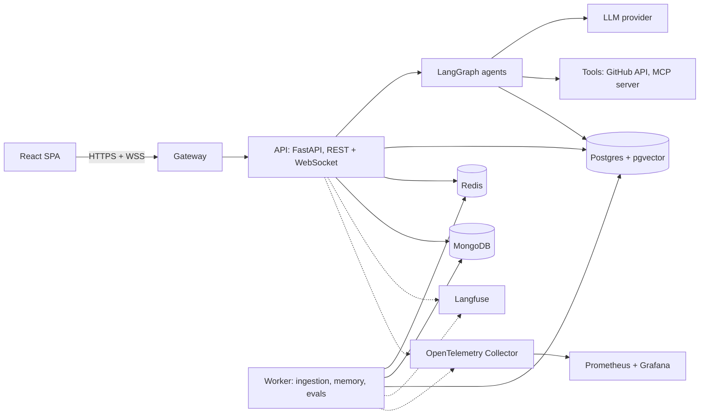

# Project brief: Triage Copilot

[← Master plan](README.md) · Next: [01 Foundations →](01-foundations.md)

Read this once fully before Phase 01, and come back to it whenever a phase mentions a component you have not built yet.

## What the product does

Four user journeys. Every phase adds to one of them.

1. **Ask the docs.** "How do we reuse auth state between Playwright tests?" The assistant retrieves from ingested documentation and answers with citations the user can click.
2. **Triage a failure.** "Why did last night's run fail?" The assistant fetches the workflow run, reads the failed job logs, classifies each failure as `product_bug`, `test_bug`, `flaky` or `infrastructure`, compares it with past failures, and explains its evidence.
3. **Act with approval.** "File an issue for the checkout failure." The assistant drafts the issue, the UI shows an approval card, and the issue is created only after the user approves or edits it.
4. **Remember.** "I own the checkout tests, and keep answers short." A later conversation honours this. The user can see and delete what is remembered.

## Architecture



Solid lines are request and data paths. Dotted lines are telemetry.

## Components

| Component | Responsibility | Built in |
|-----------|----------------|----------|
| `web` | React + TypeScript SPA: auth, conversation list, streaming chat, tool timeline, citations, approval cards, memory page | 03, extended later |
| `api` | FastAPI: REST for CRUD, WebSocket for chat, auth, rate limits, runs the agent graphs | 02, 03, 04 |
| `agents` | LangGraph graphs: router, docs agent, triage agent, action agent | 04, 06, 07, 08 |
| `worker` | Background jobs: document ingestion, memory extraction, online evals | 06, 07, 09 |
| `mcp-ci` | Your own MCP server exposing CI failure history as tools | 08 |
| `flaky-shop` | Tiny sample app with a test suite that fails on purpose, to generate labelled CI failures | 08 |
| `evals` | Datasets, evaluators, experiment runner | 06, 09 |

Start with a single Python package that has several entrypoints (`api`, `worker`, `mcp-ci`) and one container image run with different commands. Split it only if you find a concrete reason.

## Which store owns what

Getting this division clear is a learning goal in itself. Write an ADR if you change it.

| Store | Owns | Why this store |
|-------|------|----------------|
| **Postgres** | Users, projects, memberships, conversations, the user-visible message transcript, feedback, approvals | Relational, transactional, needs migrations |
| **Postgres + pgvector** | Document chunks with embeddings and full-text index | Keeps vectors next to metadata and access rules; one fewer system to run |
| **Postgres (LangGraph)** | Checkpoints (short-term, per-thread agent state) and the store (long-term memory) | Supported production backends for LangGraph persistence |
| **MongoDB** | Raw ingested documents with varying metadata, raw CI run payloads and parsed failure records, ingestion job state, tool-call audit log | Schemaless, document-shaped, append-heavy data |
| **Redis** | Per-run event streams for WebSocket fan-out and resume, rate limit counters, run locks, job queue, embedding and response caches | Ephemeral, fast, shared across replicas |
| **Langfuse** | Traces, costs, prompt versions, eval datasets and scores | Purpose-built for LLM observability |

One distinction to keep in mind from Phase 04 onward: the **message transcript** in Postgres is what the user sees; the **checkpoint** is what the agent sees. They diverge as soon as you summarise or trim context (Phase 07).

## WebSocket protocol (sketch)

You will define this properly in Phase 03. Every event has an envelope with `type`, `run_id`, a monotonically increasing `seq`, and a `payload`.

| Direction | Event types |
|-----------|-------------|
| Client → server | `user.message`, `run.cancel`, `interrupt.resume`, `ping` |
| Server → client | `run.started`, `token`, `tool.started`, `tool.finished`, `citation`, `interrupt`, `run.completed`, `error`, `pong` |

`seq` exists so a client can reconnect with `last_seq` and resume without losing or duplicating events.

## Repository layout

```text
.
├── backend/            # one Python package: api, agents, worker, mcp-ci entrypoints
├── web/                # React + Vite + TypeScript
├── flaky-shop/         # sample app with deliberately failing tests
├── evals/              # datasets (JSONL), evaluators, runner
├── tests/
│   ├── e2e/            # Playwright
│   └── load/           # k6
├── deploy/
│   ├── compose/        # local development
│   ├── helm/           # charts
│   ├── terraform/      # cloud infrastructure
│   └── gitops/         # Argo CD applications and per-environment values
├── docs/
│   ├── adr/            # architecture decision records
│   └── journal.md
├── labs/               # throwaway learning scripts from Phase 01
├── learning_plan/      # this plan
└── .github/workflows/
```

## Environments

| Environment | Where | Purpose |
|-------------|-------|---------|
| `local` | Docker Compose | Daily development |
| `kind` | Local Kubernetes | Learn Kubernetes with no cloud bill (Phase 12) |
| `staging` | Namespace in the cloud cluster | Automatic deploys from `main` |
| `prod` | Second namespace in the same cluster | Promoted deploys, canary, rollback drills |

Two namespaces in one cluster is a cost decision. A real company would normally separate clusters or subscriptions; say so if asked.

## Decisions already made, with reasons

| Decision | Reason |
|----------|--------|
| **Azure** as the cloud | You named it first, it is common in European enterprise job postings, and AKS has a free control-plane tier. A GCP mapping table is in [Phase 13](13-cloud-terraform.md) if you prefer GCP. |
| **pgvector**, not a dedicated vector database | Fewer moving parts and it teaches hybrid search in SQL. Swapping in Qdrant is a stretch task. |
| **MongoDB** as the NoSQL store | Most common document database in job postings; a natural fit for raw documents and CI payloads. |
| **Langfuse** for LLM observability | You asked for it, it is open source, and you can self-host it. |
| **Gateway API**, not ingress-nginx | ingress-nginx was retired in March 2026; Gateway API is the current standard. |
| **Helm + Argo CD** for delivery | Most common GitOps pairing; gives you a clean rollback story. |
| **Model-provider agnostic** code | Use LangChain's model abstraction so you can swap providers and compare them in evals. |

## Decisions for you to make (write an ADR for each)

- Which LLM provider and which model tiers for development, production and eval judging.
- Which embedding model, and its dimension.
- Which Redis-backed task queue for the worker.
- Hand-built `StateGraph` or `create_agent` for each agent.
- Managed Redis and MongoDB in the cloud, or run them in the cluster.

## Cost control

- **LLM spend**: set a hard monthly limit in the provider console before the first call. Use a small, cheap model for development. Use the fake LLM mode for UI work, E2E and load tests. A local model through Ollama is fine for plumbing work, but tool calling with small local models is unreliable, so do not judge your agent design on it.
- **Cloud spend**: do Phase 12 entirely on kind. Create the cloud account only when you start Phase 13, because the Azure free credit ($200) expires 30 days after sign-up. Create a budget alert in Terraform on the first day, and run `terraform destroy` at the end of each session until Phase 14.
- **Langfuse**: self-host locally with Docker Compose to learn the architecture; use Langfuse Cloud's free tier for the deployed environments unless you want the extra Kubernetes practice.

## Out of scope

Fine-tuning, training models, voice, multi-region, and a polished UI. The app does not need to be pretty. It needs to be correct, observable, evaluated and deployable.
