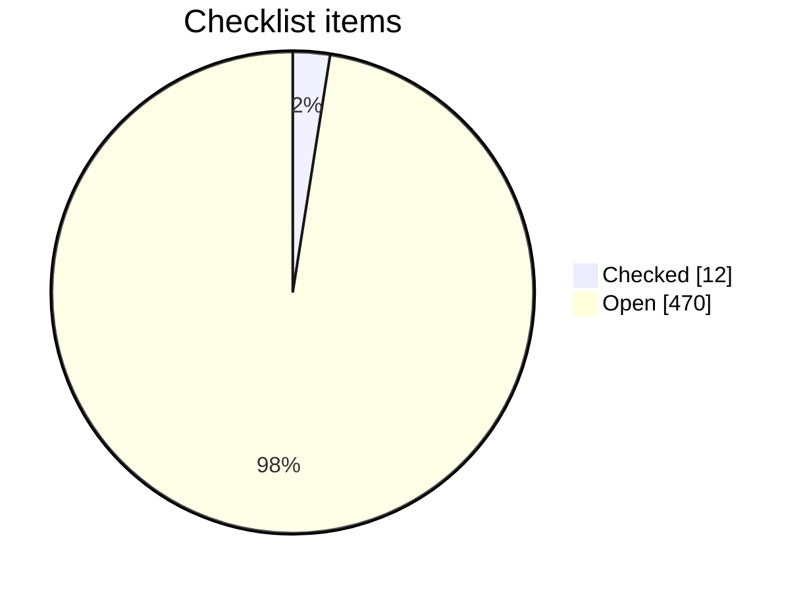
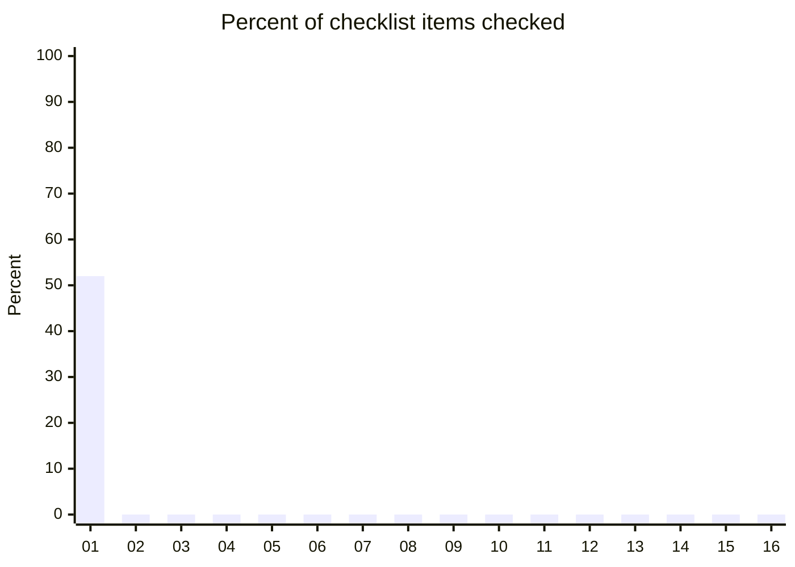
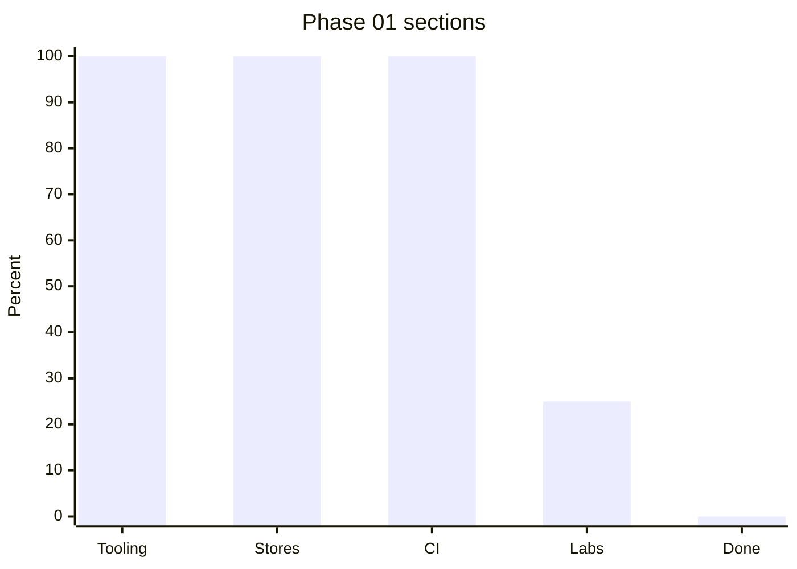

# Progress

Counts of `- [x]` and `- [ ]` in the phase files. Recounted 2026-11-15.

A phase stays open in the [plan index](README.md) until its definition of done is checked. Phase 00 has no checklist.

**12 / 482** items checked.

| Phase | Items | |
| --- | ---: | --- |
| 00 [Project brief](00-project-brief.md) | no checklist | |
| 01 [Foundations](01-foundations.md) | 12/23 | `██████████░░░░░░░░░░` |
| 02 [Backend core](02-backend-core.md) | 0/26 | `░░░░░░░░░░░░░░░░░░░░` |
| 03 [Realtime chat](03-realtime-chat.md) | 0/28 | `░░░░░░░░░░░░░░░░░░░░` |
| 04 [First agent](04-first-agent.md) | 0/26 | `░░░░░░░░░░░░░░░░░░░░` |
| 05 [LLM observability](05-llm-observability.md) | 0/21 | `░░░░░░░░░░░░░░░░░░░░` |
| 06 [RAG](06-rag.md) | 0/27 | `░░░░░░░░░░░░░░░░░░░░` |
| 07 [Context and memory](07-context-and-memory.md) | 0/27 | `░░░░░░░░░░░░░░░░░░░░` |
| 08 [Multi-agent, human-in-the-loop, MCP](08-multi-agent-hitl-mcp.md) | 0/36 | `░░░░░░░░░░░░░░░░░░░░` |
| 09 [Evals and testing](09-evals-and-testing.md) | 0/45 | `░░░░░░░░░░░░░░░░░░░░` |
| 10 [Guardrails and security](10-guardrails-security.md) | 0/25 | `░░░░░░░░░░░░░░░░░░░░` |
| 11 [CI pipeline](11-ci-pipeline.md) | 0/31 | `░░░░░░░░░░░░░░░░░░░░` |
| 12 [Kubernetes locally](12-kubernetes-local.md) | 0/34 | `░░░░░░░░░░░░░░░░░░░░` |
| 13 [Cloud with Terraform](13-cloud-terraform.md) | 0/32 | `░░░░░░░░░░░░░░░░░░░░` |
| 14 [CD, rollbacks, migrations](14-cd-rollbacks-migrations.md) | 0/34 | `░░░░░░░░░░░░░░░░░░░░` |
| 15 [Monitoring and operations](15-monitoring-operations.md) | 0/39 | `░░░░░░░░░░░░░░░░░░░░` |
| 16 [Capstone and job prep](16-capstone-job-prep.md) | 0/28 | `░░░░░░░░░░░░░░░░░░░░` |

## Phase 01

12/23. Repository and tooling, the local stores, the first CI setup, and the chat-call and statelessness labs are done. The other labs and the definition of done are open.

| Section | Items | |
| --- | ---: | --- |
| Repository and tooling | 6/6 | `████████████████████` |
| Local dependencies | 2/2 | `████████████████████` |
| First CI | 2/2 | `████████████████████` |
| LLM lab | 2/8 | `█████░░░░░░░░░░░░░░░` |
| Definition of done | 0/5 | `░░░░░░░░░░░░░░░░░░░░` |
